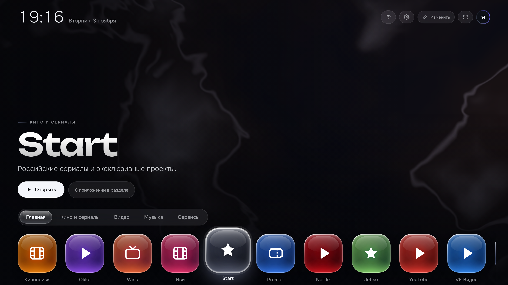

# Домашний экран ТВ (веб-версия)

Минималистичный домашний экран для телевизора одной HTML-страницей (`index.html`):
живой фон, который перекрашивается в цвет выбранного приложения, плитки и вкладки
в стиле жидкого стекла, управление стрелками пульта и настройки (яркость, ночной режим,
размер интерфейса, цвет фона, формат часов, заставка с часами, таймер сна).

Плитки открывают веб-версии сервисов. Свои плитки добавляются кнопкой «Изменить» (или клавишей E),
они сохраняются в браузере, где их добавили.



## Установка на ТВ через adb

Из папки с adb (`C:\Users\User\platform-tools`), по одной команде:

```powershell
.\adb.exe connect 192.168.0.102:5555
.\adb.exe push C:\путь\к\tv-home-web\index.html /sdcard/Download/tv-home.html
.\adb.exe shell am start -a android.intent.action.VIEW -d "file:///sdcard/Download/tv-home.html" -t text/html -p com.yandex.browser.tv
```

## Управление

| Кнопка | Действие |
|---|---|
| ← → | выбор плитки или вкладки |
| ↑ ↓ | плитки → вкладки → кнопки сверху (настройки, изменить, весь экран) |
| OK / Enter | открыть |
| E, F, S | изменить плитки, весь экран, настройки (с клавиатуры) |
